# Aula 6 · O Universo da IA e o Seu Site Pessoal

Vitto abriu uma vaga de estágio e recebeu quarenta currículos. Trinta e oito eram PDFs parecidos. Dois traziam um link: um site simples, com a história da pessoa, projetos e um jeito fácil de entrar em contato. Vitto chamou esses dois primeiro.

Hoje você publica o seu site. No caminho, vai entender o que é a IA generativa, por que ela erra, como esse universo se organiza e como pedir as coisas do jeito certo. Nas próximas aulas, cada projeto novo entra nesse site.

## IA, machine learning, deep learning e IA generativa

Esses quatro nomes aparecem misturados em notícia, propaganda e conversa de corredor. Eles não são sinônimos. Cada um é uma camada dentro da anterior, como bonecas russas.

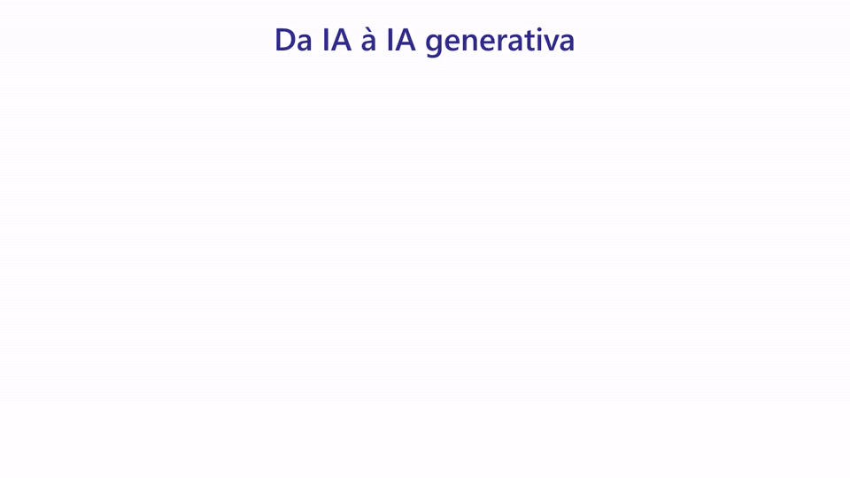

**Inteligência artificial** é o campo inteiro: qualquer programa que faz uma tarefa que parecia exigir uma pessoa. No começo, isso era feito com **regras escritas à mão**. Uma pessoa pensava em todos os casos e programava cada um.

* No Vitto: "se for a décima pizza do cliente, dê 10% de desconto".
* No dia a dia: o atendimento telefônico do banco ("digite 1 para saldo"), o GPS que calcula a rota mais curta, o computador que venceu o campeão mundial de xadrez em 1997.

Regras funcionam quando o problema é claro. Falham quando ninguém consegue escrever a regra. Tente escrever regras para reconhecer uma pizza numa foto: cor, formato, borda... sempre aparece uma exceção.

**Machine learning** (aprendizado de máquina) inverte o jogo. Em vez de escrever as regras, você mostra exemplos com as respostas certas, e o programa descobre as regras sozinho.

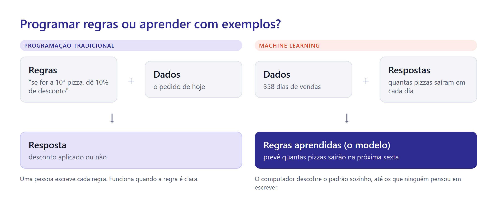

* No Vitto: mostrar ao computador os 358 dias de vendas e quantas pizzas saíram em cada um. Ele aprende a prever a próxima sexta-feira.
* No dia a dia: o filtro de spam do e-mail, a recomendação de filmes do streaming, o banco que bloqueia uma compra suspeita no cartão, o score de crédito.

**Deep learning** (aprendizado profundo) é um tipo de machine learning que usa **redes neurais** grandes: muitas camadas de "neurônios" artificiais empilhadas. Cada camada aprende algo um pouco mais complexo que a anterior.

```mermaid
%%{init:{"theme":"base","themeVariables":{"fontFamily":"'Segoe UI',Inter,Helvetica,Arial,sans-serif","fontSize":"15px","primaryColor":"#F3F4F8","primaryTextColor":"#171A2B","primaryBorderColor":"#DFE2EA","lineColor":"#8C90A6","secondaryColor":"#E4E2FB","tertiaryColor":"#FFFFFF","clusterBkg":"#F7F8FB","clusterBorder":"#DFE2EA","edgeLabelBackground":"#FFFFFF"},"flowchart":{"nodeSpacing":28,"rankSpacing":38,"padding":14,"curve":"basis"}}}%%
flowchart LR
    A("<b>Foto</b><br/><i>milhões de pontos coloridos</i>") --> B("<b>Camadas iniciais</b><br/><i>bordas e cores</i>")
    B --> C("<b>Camadas do meio</b><br/><i>círculos, manchas de queijo</i>")
    C --> D("<b>Camadas finais</b><br/><i>formas inteiras</i>")
    D --> E("<b>Resposta</b><br/><i>é uma pizza!</i>")
    classDef neutro fill:#F3F4F8,stroke:#DFE2EA,color:#171A2B;
    classDef claro fill:#E4E2FB,stroke:#C9C5F5,color:#171A2B;
    classDef medio fill:#B9B5F2,stroke:#A29DEB,color:#171A2B;
    classDef forte fill:#4F46E5,stroke:#4F46E5,color:#FFFFFF;
    classDef destaque fill:#2F2A8F,stroke:#2F2A8F,color:#FFFFFF;
    class A neutro
    class B claro
    class C medio
    class D forte
    class E destaque
```

Ninguém programa "manchas de queijo". A rede descobre sozinha, olhando milhões de exemplos. O deep learning é o que fez a IA entender o que é difícil de descrever com regras: imagens, voz e linguagem.

* No dia a dia: o desbloqueio do celular pelo rosto, o assistente que entende o que você fala, o tradutor automático, o carro que lê placas de trânsito.

**IA generativa** é deep learning que, em vez de só classificar ou prever, **cria algo novo**: texto, imagem, música, vídeo, código.

* No Vitto: escrever a descrição de uma pizza nova para o cardápio, criar a arte da promoção de terça, montar o site da pizzaria.
* No dia a dia: o ChatGPT escrevendo um e-mail, o Midjourney criando uma imagem, o Suno compondo uma música.

| Camada | O que faz | Precisa de | Exemplo |
| --- | --- | --- | --- |
| Inteligência artificial (regras) | segue regras escritas por pessoas | alguém que conheça todos os casos | desconto na décima pizza |
| Machine learning | aprende padrões a partir de exemplos | dados com as respostas certas | prever as vendas de sexta |
| Deep learning | aprende padrões complexos com redes neurais | muitos dados e muito poder de computação | reconhecer a foto de uma pizza |
| IA generativa | cria conteúdo novo | quantidades gigantes de texto, imagens e código | escrever o texto do cardápio |


**Para não confundir:** toda IA generativa é deep learning, todo deep learning é machine learning, e todo machine learning é IA. O contrário não vale: a regra do desconto é IA, mas não aprende nada.


## Como um modelo de linguagem funciona

O coração do ChatGPT, do Claude e do Gemini é um **modelo de linguagem**. A ideia central cabe numa frase: ele escolhe o próximo pedaço de texto mais provável, depois o próximo, depois o próximo.

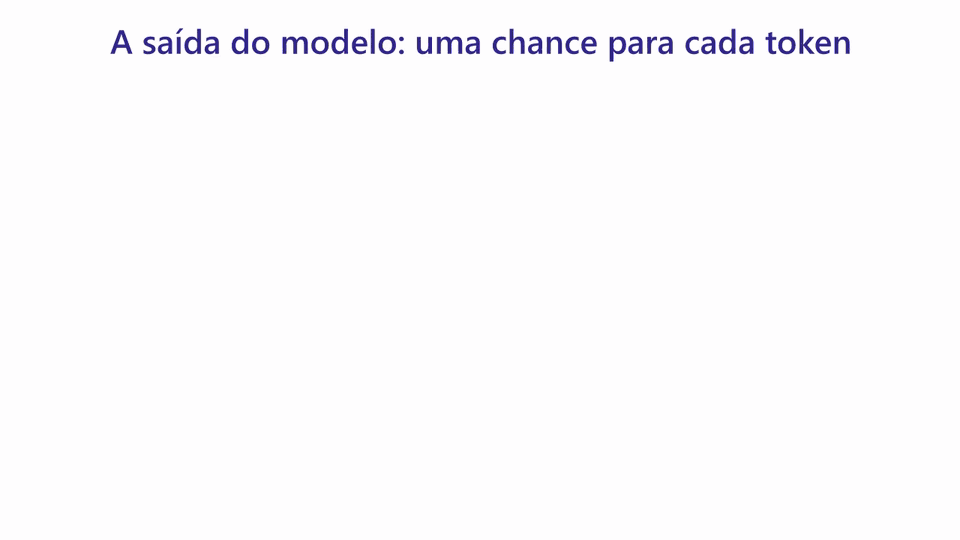

Pense no autocompletar do celular, só que treinado com uma quantidade enorme de texto: livros, sites, código, conversas. Ao ler tanto, o modelo aprendeu padrões de gramática, de fatos e até de raciocínio. Quando você escreve "A pizza mais vendida do Vitto é a", ele calcula quais continuações soam mais prováveis, sorteia uma, cola no texto e repete.

Esse sorteio explica uma coisa que confunde muita gente: **a mesma pergunta gera respostas diferentes**. Não é defeito. É o jeito como o modelo funciona.


**Treino em duas etapas.** Primeiro o modelo lê bilhões de páginas e aprende a continuar textos. Depois, pessoas avaliam milhares de respostas ("esta é útil, esta não é") e o modelo aprende a conversar, seguir instruções e recusar pedidos perigosos.


O treino termina numa data. Tudo o que aconteceu depois é desconhecido para o modelo. Essa é a **data de corte**. Por isso os apps de chat ganharam busca na web: quando você pergunta algo recente, o app pesquisa e entrega o resultado para o modelo ler.

## Tokenização: o texto vira pedaços numerados

O modelo não lê letras nem palavras inteiras. Antes de tudo, um programa chamado **tokenizador** corta o texto em pedaços, os **tokens**, e troca cada pedaço por um número. O modelo só enxerga a sequência de números.

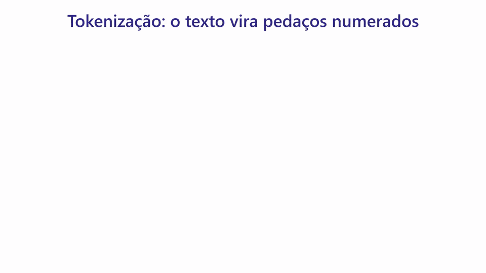

O exemplo da animação é real. É assim que o tokenizador usado pelos modelos da OpenAI corta a frase "A pizza mais vendida do Vitto é a":

| Pedaço | `A` | ` pizza` | ` mais` | ` vend` | `ida` | ` do` | ` Vit` | `to` | ` é` | ` a` |
| --- | --- | --- | --- | --- | --- | --- | --- | --- | --- | --- |
| Número | 32 | 27941 | 2899 | 10593 | 2261 | 621 | 27283 | 935 | 1212 | 261 |

Repare em três coisas:

* **O espaço faz parte do pedaço.** " pizza", com o espaço na frente, é um token diferente de "pizza" colado.
* **Palavras comuns viram um token só; palavras raras viram vários.** "pizza" é um pedaço; "vendida" virou "vend" + "ida"; "Vitto", um nome que o tokenizador não conhece, virou "Vit" + "to".
* **Português gasta mais tokens que inglês.** A frase acima tem 8 palavras e 10 tokens. "The best pizza in town" tem 5 palavras e 5 tokens. Os tokenizadores foram montados com muito mais texto em inglês.

Por que isso importa para você?

* **Custo:** pela API, paga-se por token (Aula 10). O mesmo texto em português sai um pouco mais caro.
* **Limite:** a janela de contexto (veja abaixo) é medida em tokens, não em páginas.
* **Erros curiosos:** como o modelo vê pedaços e não letras, ele pode errar perguntas como "quantas letras r tem a palavra *carrinho*?". Ele nunca viu as letras separadas.


**Veja com os próprios olhos.** Ferramentas como o *Tokenizer* da OpenAI (platform.openai.com/tokenizer) mostram, em cores, como qualquer texto é cortado. Cole uma frase sua e compare com a mesma frase em inglês.


## Embeddings: um mapa de sentidos

Tokens são só números de identificação: o 27941 ("pizza") não está "perto" do 27942 em sentido nenhum. Para o modelo entender significado, cada pedaço de texto ganha também um **embedding**: uma posição num mapa de sentidos.

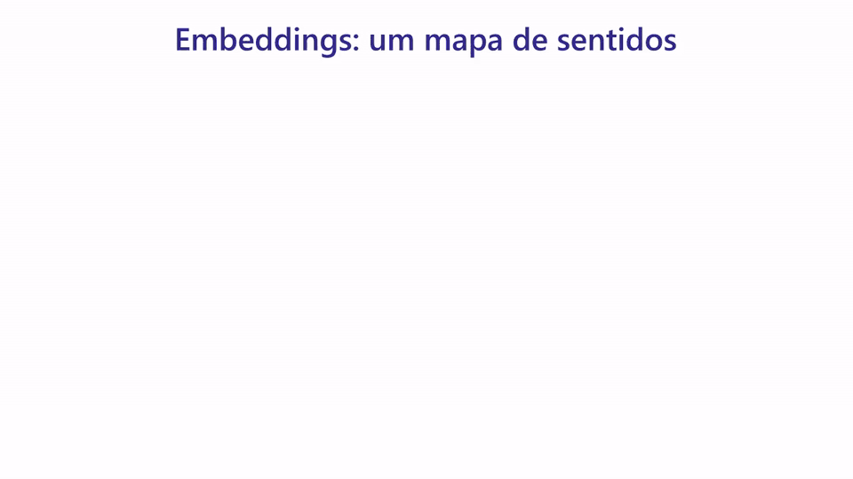

Pense num mapa de uma cidade, mas organizado por assunto. Textos com sentido parecido moram no mesmo bairro, mesmo sem nenhuma palavra em comum: "mussarela", "parmesão" e "fornecedor de queijo" ficam perto; "segunda-feira" e "sábado", em outro bairro; "preço" e "promoção", em outro.

* **Busca por sentido:** perguntar "o queijo vai atrasar?" encontra o trecho "o fornecedor atrasou o pedido", mesmo sem a palavra "queijo". Uma busca por palavra-chave não acharia.
* **Recomendação:** "quem comprou esta pizza também gostou de..." usa a mesma ideia: itens parecidos ficam perto.
* **Na Aula 10:** o seu agente pessoal vai usar embeddings para encontrar, nos seus PDFs, os trechos que respondem à pergunta. Essa técnica se chama RAG.


O mapa da animação tem duas dimensões para caber na tela. Os mapas reais têm centenas ou milhares de dimensões. Você não precisa imaginá-las: basta a ideia de que **perto no mapa é perto no sentido**.


## Por que a IA inventa

Pergunte a um chat, sem anexar nada: "qual foi a pizza mais vendida da Pizzaria do Vitto em 2025?". Ele pode responder, com toda a segurança, "a Margherita, com 18% das vendas". Nunca houve Margherita no cardápio do Vitto.

Isso se chama **alucinação**: uma resposta que soa certa e é falsa. Ela acontece porque o modelo foi treinado para produzir texto provável, não para dizer "não sei". Se ele não recebeu os dados, completa a lacuna com o que parece plausível.


A alucinação é mais perigosa justamente onde parece mais confiável: números, nomes, datas, citações e referências bibliográficas. Todo número que vai para um relatório precisa vir dos dados, nunca da "memória" do modelo.


Três atitudes reduzem o problema:

* **Dê os dados.** Anexe a planilha, cole o texto, aponte o arquivo. A IA passa a trabalhar sobre o que você deu.
* **Peça a fonte.** "De onde veio esse número?" obriga o modelo a mostrar o caminho.
* **Confira o que importa.** Você já sabe muita coisa sobre os dados do Vitto. Use esse conhecimento para checar.

## Janela de contexto: a mesa de trabalho

Tudo o que o modelo considera ao responder precisa estar na **janela de contexto**. Imagine uma mesa de trabalho. Em cima dela estão as instruções, a conversa até aqui, os arquivos que você anexou e os resultados das ferramentas. O que não está na mesa, o modelo não vê.

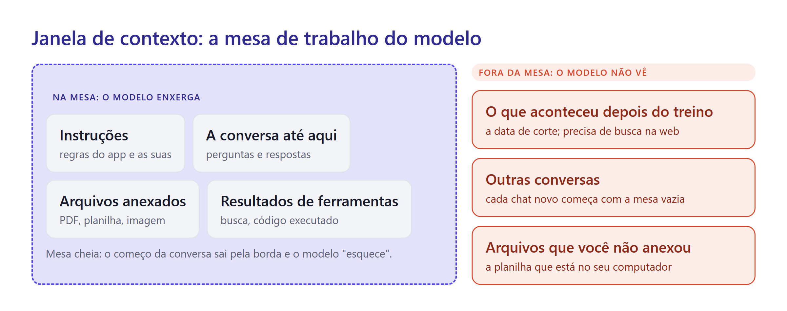

A mesa é grande, mas tem limite, medido em tokens. Os modelos mais novos aceitam por volta de um milhão de tokens, algo como alguns livros inteiros. Mesmo assim, numa conversa muito longa, o modelo presta menos atenção ao que ficou lá no começo. Isso tem duas consequências práticas:

* **Assunto novo, conversa nova.** Uma conversa limpa, só com o que importa, dá respostas melhores do que uma conversa de duas horas sobre cinco temas.
* **Cada conversa começa vazia.** O chat de ontem não sabe o que você disse hoje, a menos que o app tenha um recurso de memória ou você cole o contexto de novo.

## O universo da IA em camadas

Há centenas de ferramentas de IA, e os nomes mudam a cada poucos meses. Em vez de decorar nomes, entenda as camadas. Qualquer ferramenta nova cabe numa delas.

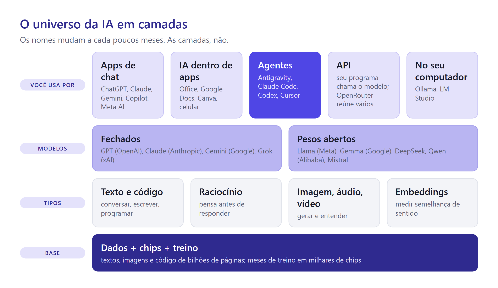

**Base.** Tudo começa com dados, chips e treino. Treinar um modelo grande custa centenas de milhões de dólares, por isso poucas empresas fazem isso: OpenAI, Anthropic, Google, Meta, SpaceXAI (dona do Grok), Mistral, DeepSeek, Alibaba e algumas outras.

**Modelos.** O resultado do treino é um modelo. Ele pode ser **fechado** ou ter **pesos abertos**.

* Um modelo fechado (GPT, Claude, Gemini, Grok) só pode ser usado pelos apps e pela API da empresa. Você nunca tem o arquivo do modelo.
* Um modelo de pesos abertos (DeepSeek, Kimi, GLM, Qwen, Llama, Gemma) pode ser baixado e rodado em qualquer computador potente. Uma empresa preocupada com sigilo pode rodá-lo nos próprios servidores, sem mandar dado nenhum para fora.

**Tipos de modelo.** Há modelos para texto e código, modelos de **raciocínio** (que "pensam" por alguns segundos ou minutos antes de responder e acertam mais em problemas difíceis), modelos de imagem, áudio e vídeo e modelos de **embeddings**, que fazem o mapa de sentidos.

**Formas de usar.** É aqui que você entra.

| Forma de uso | O que é | Exemplo para o Vitto |
| --- | --- | --- |
| App de chat | você conversa num site ou aplicativo | pedir ideias de promoção para terça-feira |
| IA dentro de apps | o modelo aparece no programa que você já usa | resumir as reclamações numa planilha do Google |
| Agente | a IA executa tarefas no computador: cria arquivos, roda programas, abre o navegador | construir o dashboard de vendas |
| API | um programa seu conversa com o modelo | um robô que responde clientes no WhatsApp |
| Modelo local | o modelo roda no seu computador, sem internet | analisar dados sigilosos sem enviá-los a ninguém |

O [Catálogo de ferramentas de IA](ferramentas.md) mostra quase 50 ferramentas, comerciais e abertas, organizadas por tarefa: conversa, pesquisa, programação, imagem, vídeo, áudio, design e automação.


**Usuário avançado escolhe a ferramenta pela tarefa.** Pergunta rápida: chat. Pesquisa com fontes: chat com busca na web ou "pesquisa aprofundada". Trabalho sobre arquivos e código: agente. Dado sigiloso: modelo local ou plano empresarial que não treina com seus dados.


## Os modelos e seus desempenhos

Cada empresa lança **famílias** de modelos, em tamanhos diferentes. Os maiores acertam mais e custam mais; os menores são rápidos e baratos.

| Empresa | Modelos (outubro de 2026) | Como a família se divide |
| --- | --- | --- |
| Anthropic | Claude Opus 5.5, Claude Sonnet 5.5, Claude Haiku 5.5 | Opus é o maior; Sonnet equilibra qualidade e custo; Haiku é o mais rápido e barato |
| OpenAI | GPT-6 (variantes como Astra e Sol); gpt-oss (pesos abertos) | os modelos GPT ficam no ChatGPT e na API; os gpt-oss podem ser baixados |
| Google | Gemini 4 (como o Argon), Gemini 3.5 Flash-Lite; Gemma 4 (pesos abertos) | o Flash-Lite é rápido e barato; o Gemma roda até em computadores comuns |
| SpaceXAI | Grok 4.7 | modelo do Grok, integrado ao X |
| Meta | Muse; Llama 4 (pesos abertos) | o Llama popularizou os modelos de pesos abertos |
| Chinesas | DeepSeek V4, Kimi K3 (Moonshot AI), GLM-5.3 (Z AI), MiMo (Xiaomi), Qwen 3.7 (Alibaba) | quase todas publicam pesos abertos, com preços muito baixos |
| Mistral (França) | Mistral Large 4 (prévia), Mistral Small 4 | a principal empresa europeia |

Como saber qual modelo é "melhor"? Laboratórios independentes aplicam a mesma bateria de provas a todos os modelos, como um ENEM de IA: questões de raciocínio, matemática, ciência, programação e uso de ferramentas. A **Artificial Analysis** resume essas provas num índice de inteligência:

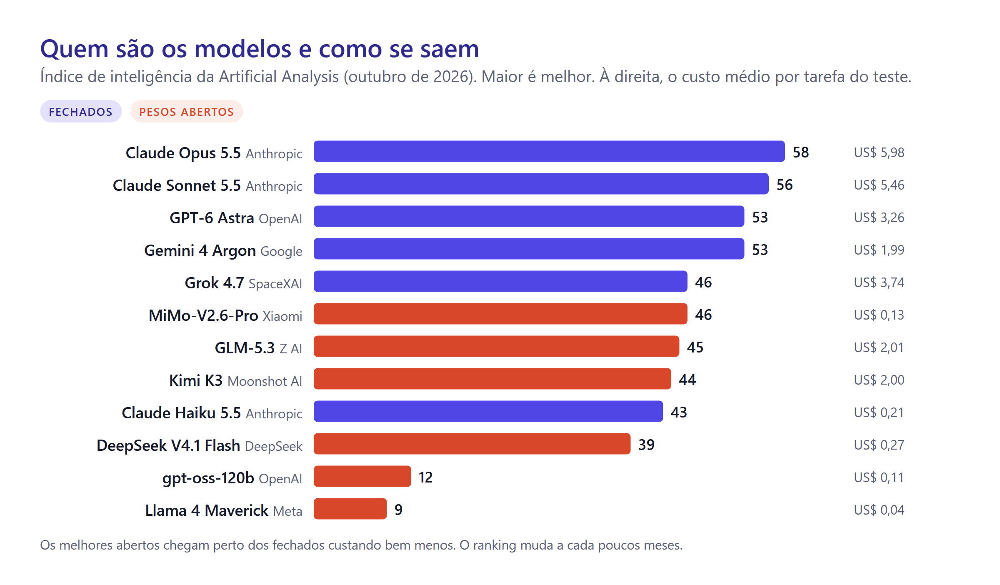

Três leituras do gráfico:

* **Os fechados lideram, mas os abertos estão perto.** O melhor modelo de pesos abertos (MiMo, da Xiaomi) fica a 12 pontos do líder, custando cerca de 45 vezes menos por tarefa.
* **Maior nem sempre compensa.** O Claude Haiku 5.5 faz 43 pontos com custo de US\$ 0,21 por tarefa; o Opus faz 58 com US\$ 5,98. Para resumir um e-mail, o pequeno basta.
* **Modelos antigos envelhecem rápido.** O Llama 4, que foi destaque em 2025, hoje fica no fim da lista. Em IA, um ano é muito tempo.


Ranking não é tudo. Um modelo pode ir muito bem na prova e mal na **sua** tarefa. Os rankings mudam a cada poucos meses: consulte a fonte atualizada (artificialanalysis.ai e lmarena.ai, onde pessoas votam às cegas na melhor resposta) e, sobretudo, teste com os seus próprios exemplos. Na Aula 10, você vai aprender a montar esse teste.


## Os conectores: OpenRouter, Composio e companhia

Entre os modelos e as ferramentas que você usa, existe uma camada de serviços que conecta as peças. Você vai ouvir esses nomes o tempo todo.

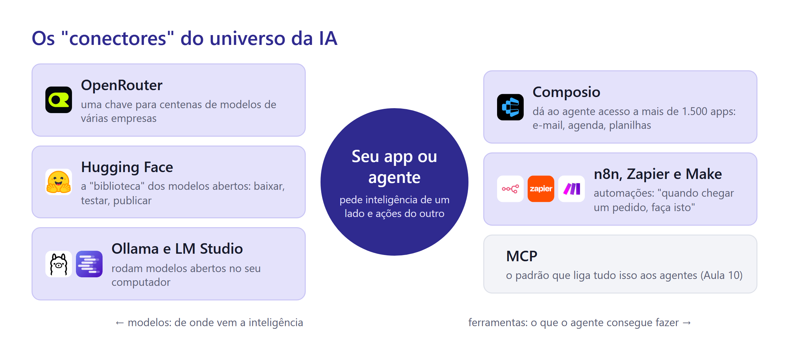

**Do lado dos modelos (de onde vem a inteligência):**

*  **OpenRouter** é um balcão único para modelos. Em vez de abrir conta e pagar separado na OpenAI, na Anthropic, no Google e em dezenas de outras, você usa **uma chave** e escolhe entre centenas de modelos, inclusive alguns gratuitos. Trocar de modelo vira trocar um nome. Você vai usá-lo na Aula 10.
*  **Hugging Face** é a grande biblioteca dos modelos abertos. Quase todo modelo de pesos abertos é publicado lá, com dados de treino, demonstrações e documentação. É o "GitHub da IA".
*  **Ollama** e  **LM Studio** baixam um modelo aberto e o rodam no seu computador, sem internet e sem enviar dados a ninguém. Modelos pequenos rodam até em notebooks comuns.

**Do lado das ferramentas (o que o agente consegue fazer):**

*  **Composio** dá a um agente acesso a mais de 1.500 aplicativos, como Gmail, Google Agenda, Slack e planilhas, cuidando dos logins com segurança. Com ele, um agente pode, por exemplo, ler os e-mails de fornecedores e marcar uma reunião na sua agenda. O plano gratuito permite 100 mil ações por mês (outubro de 2026).
*  **n8n**,  **Zapier** e  **Make** montam automações do tipo "quando acontecer isto, faça aquilo": quando chegar um pedido pelo formulário, registre na planilha e avise no WhatsApp. Hoje todos têm passos com IA no meio do fluxo. O n8n pode ser instalado nos seus próprios servidores.
* **MCP** é o padrão que liga ferramentas a qualquer agente, como uma tomada USB-C. Você vai conhecê-lo na Aula 10.


Uma forma simples de lembrar: **OpenRouter escolhe o cérebro; Composio e MCP dão as mãos.** Um agente útil precisa dos dois.


## Três agentes: Antigravity, OpenCode e Cursor

Um chat responde. Um **agente** age. Ele recebe um objetivo, faz um plano, usa ferramentas (editor de arquivos, terminal, navegador), observa o resultado e repete até terminar. Na Aula 8 você vai ver esse ciclo em detalhe. Hoje basta usar.

Você vai conhecer três agentes, todos com plano gratuito:

| | Google Antigravity | OpenCode | Cursor |
| --- | --- | --- | --- |
| O que é | ambiente feito para agentes, do Google | agente de código aberto | editor de código com agente embutido |
| Como se usa | aplicativo de desktop | aplicativo de desktop, terminal ou extensão de editor | aplicativo de desktop |
| Modelos no gratuito | Gemini, com cota semanal | modelos gratuitos do OpenCode Zen, que mudam com o tempo | modelos Grok, com cota inicial limitada |
| Destaque | planos e capturas de tela para revisar | aberto e configurável; pode usar quase qualquer modelo | editor completo, muito usado no mercado |

*Planos gratuitos em outubro de 2026. Eles mudam com frequência: o do Cursor, por exemplo, mudou nesse mês, quando a empresa passou a fazer parte da SpaceX.*

Por que três? Porque nenhum agente é o melhor em tudo, e porque **as cotas gratuitas acabam**. Quem sabe usar mais de um troca de ferramenta e continua trabalhando. E o que você aprende vale para todos: pedir bem, revisar o plano, conferir o resultado.

Os três têm em comum o que importa para você:

* **Planejar antes de agir.** No Antigravity, o modo de planejamento (ou o comando `/plan`) gera um plano de implementação que você comenta e aprova com **Proceed**. No OpenCode, a tecla **Tab** alterna entre o agente **Plan**, que só propõe, e o **Build**, que executa. Em qualquer agente, funciona dizer: "não altere nada ainda, só me mostre o plano".
* **Pedir permissão antes de rodar comandos.** Deixe essa opção ligada e leia cada comando antes de aprovar.
* **Ler o arquivo `AGENTS.md`.** Os três seguem as regras escritas num arquivo `AGENTS.md` na pasta do projeto. Você vai usar isso a partir da Aula 7: as mesmas regras servem para qualquer agente.


O agente roda comandos no seu computador. Leia cada comando antes de aprovar. Se não entender, pergunte ao próprio agente: "o que esse comando faz?".



**Usuário avançado não depende de uma ferramenta só.** Dê a mesma spec a dois agentes e compare os resultados. Onde eles discordam, há algo para você decidir.


## Técnica de prompting: a anatomia do pedido

Pedir "faz um site pra mim" funciona, mas o resultado é genérico. O agente preenche tudo o que você não disse com o que é mais comum. Um bom pedido tem até cinco partes:

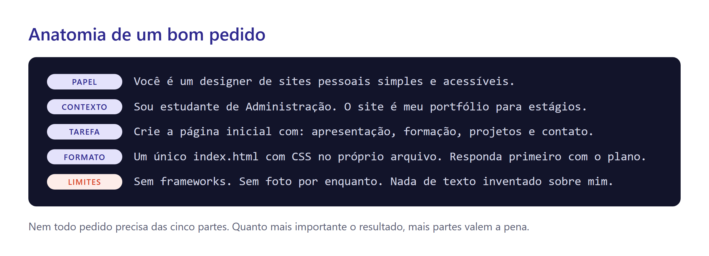

* **Papel:** quem a IA deve ser. Muda o vocabulário e o nível da resposta.
* **Contexto:** quem é você, para quem é o resultado, por que ele existe.
* **Tarefa:** o que exatamente deve ser feito, com verbo claro.
* **Formato:** como o resultado deve vir (arquivo, tabela, tamanho, tom).
* **Limites:** o que **não** fazer. É a parte mais esquecida e a que mais evita retrabalho.

Compare os dois pedidos para o mesmo objetivo:

```text
Faz um site pessoal pra mim.
```

```text
Você é um designer de sites pessoais simples e acessíveis.
Sou estudante de Administração e quero um portfólio para estágios.
Crie a página inicial com: apresentação, formação, projetos e contato.
Use um único index.html com o CSS no próprio arquivo.
Não use frameworks e não invente informações sobre mim: onde faltar dado, deixe [PREENCHER].
Antes de criar, me mostre o plano.
```

O segundo pedido gasta trinta segundos a mais e economiza dez minutos de correções.


**Deixe a IA perguntar.** Termine pedidos importantes com: "Antes de começar, faça até 5 perguntas sobre o que não ficou claro." O modelo descobre as lacunas por você.


## Spec-driven development, parte 1: pense antes de pedir

Quando o pedido cresce, ele merece ir para um arquivo. Esse arquivo se chama **spec** (de *specification*, especificação). Ele descreve **o quê** você quer e **por quê**, sem se preocupar com **como** vai ser feito.

Trabalhar a partir de uma spec tem nome: **spec-driven development** (desenvolvimento guiado por especificação). A ideia do GitHub, que popularizou o termo, é simples: o problema raramente é a habilidade do agente; é o pedido vago. Com uma spec, o agente trabalha sobre algo claro, e você revisa cada etapa.

Nesta aula, a spec é curta. Na Aula 9, você vai ver o ciclo completo.

```markdown
# Spec: meu site pessoal

## Objetivo
Portfólio para conseguir estágio em [área]. Quem ler deve entender em 30 segundos quem sou e como falar comigo.

## Público
Recrutadores e gestores de pequenas empresas, lendo pelo celular.

## Conteúdo
- Apresentação: nome, curso, semestre, uma frase sobre o que procuro.
- Formação e cursos.
- Projetos: por enquanto vazio, com o texto "em breve". Vai receber os projetos das aulas 7 a 10.
- Contato: e-mail e LinkedIn.

## Estilo
Limpo, uma cor de destaque, boa leitura no celular. Referência: [link de um site que você acha bonito].

## Limites
- Nada de CPF, telefone, endereço ou data de nascimento.
- Nenhuma informação inventada.
- Um único index.html, sem frameworks.

## Pronto quando
- Abre no celular sem barra de rolagem lateral.
- Todos os links funcionam.
- Publicado em usuario.github.io.
```

A última seção, **"pronto quando"**, é a mais valiosa. Ela transforma "ficou bom?" em perguntas de sim ou não. O agente pode usá-la para conferir o próprio trabalho, e você também.

## Git, GitHub e GitHub Pages

Três nomes parecidos, três coisas diferentes:

* **Git** é um programa que tira "fotos" da sua pasta de projeto. Cada foto se chama **commit** e leva uma mensagem: "cria página inicial", "corrige link do LinkedIn". Se algo der errado, você volta para uma foto anterior.
* **GitHub** é um site que guarda essas fotos na nuvem. Enviar os commits para lá se chama **push**. Cada projeto fica num **repositório**.
* **GitHub Pages** é um serviço gratuito do GitHub que transforma um repositório em site público.

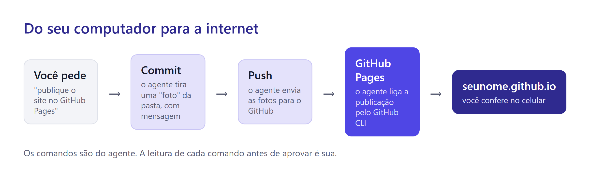

Você não precisa decorar comandos nem clicar em menus do GitHub. Na preparação, você conectou o computador ao GitHub com o **GitHub CLI** (`gh`). A partir daí, o agente usa o `git` e o `gh` para criar o repositório, salvar as fotos, enviar e ligar a publicação. O seu trabalho é **pedir** com clareza, **ler** cada comando antes de aprovar e **conferir** o resultado no navegador.


No plano gratuito do GitHub, o repositório de um site do GitHub Pages é **público**: qualquer pessoa vê todos os arquivos, inclusive versões antigas. Nunca coloque ali senha, chave de API, telefone ou documento. Apagar depois não resolve: o histórico guarda tudo.


## Projeto: o seu site no ar

Escolha um dos três agentes para este projeto. Os prompts funcionam em qualquer um.

**Passo 1. Abra uma pasta de projetos.** Crie uma pasta onde vai guardar os projetos da disciplina, por exemplo `Documentos/projetos-ia`, e abra essa pasta no agente.

**Passo 2. Peça ao agente para criar o repositório.**

```text
Use o GitHub CLI (gh) para:
1. descobrir o meu usuário do GitHub;
2. criar um repositório público chamado USUARIO.github.io (com o meu usuário em minúsculas);
3. cloná-lo nesta pasta e abrir a pasta clonada como projeto.
Me mostre cada comando antes de rodar.
```

Se o `gh` disser que você não está conectado, volte à página de preparação e refaça o `gh auth login`.

**Passo 3. Escreva a spec.** Crie o arquivo `spec.md` na pasta do projeto, copie o modelo da seção anterior e preencha. Se travar, peça ajuda ao agente:

```text
Quero escrever a spec do meu site pessoal no arquivo spec.md, usando o modelo que vou colar.
Me entreviste: faça uma pergunta por vez e, no fim, preencha o arquivo com as minhas respostas.
Não invente nada que eu não tenha dito.
```

**Passo 4. Peça o plano.** Ligue o modo de planejamento do seu agente (ou diga que não é para alterar nada ainda):

```text
Leia o spec.md e planeje o meu site pessoal seguindo essa spec à risca.
Não altere nenhum arquivo ainda: mostre o plano e espere a minha aprovação.
```

Leia o plano. Ele bate com a spec? Ficou faltando alguma seção? Corrija o que estiver errado e só então autorize a execução.

**Passo 5. Veja o resultado.** Peça ao agente para abrir o site no navegador e mostrar como fica em tamanho de celular. Confira com o "pronto quando" da spec.

**Passo 6. Melhore em rodadas curtas.** Uma mudança por pedido funciona melhor que dez de uma vez:

```text
Na seção de apresentação, o texto está longo. Reduza para duas frases, mantendo as informações.
```

```text
Anexei um print de um site que eu gosto. Use a mesma ideia de cabeçalho no meu site,
sem copiar textos nem imagens.
```

**Passo 7. Peça a publicação.**

```text
Publique o site:
1. faça um commit com a mensagem "primeira versão do site" e envie para o GitHub;
2. com o gh, confira se o GitHub Pages está ligado para a branch main, na raiz;
   se não estiver, ligue;
3. me diga o endereço do site e avise quando ele estiver no ar.
```

Leia os comandos antes de aprovar. Para ligar o Pages, o agente costuma usar um comando como `gh api --method POST repos/USUARIO/USUARIO.github.io/pages -f "source[branch]=main" -f "source[path]=/"`. A publicação pode levar até 10 minutos. Depois, abra `https://seuusuario.github.io` no celular.


Se algo travar no GitHub, peça ao agente: "verifique com o gh o estado do repositório e do GitHub Pages e me explique o problema em linguagem simples". Ele consegue diagnosticar quase tudo sozinho.


## Checklist do projeto

* [ ] O site abre em `https://seuusuario.github.io`, inclusive no celular.
* [ ] Todos os itens do "pronto quando" da spec estão cumpridos.
* [ ] Nenhuma informação foi inventada pela IA (procure por `[PREENCHER]` e por frases que você não escreveria).
* [ ] Não há telefone, endereço, CPF ou data de nascimento em nenhum arquivo.
* [ ] A seção de projetos existe e está pronta para receber os próximos trabalhos.

## Truques de usuário avançado


* **Peça três versões.** "Me mostre três propostas de cabeçalho, bem diferentes entre si." Escolher é mais fácil que descrever.
* **Mostre em vez de descrever.** Um print vale um parágrafo de explicação. Os modelos atuais leem imagens.
* **Compare modelos.** Faça a mesma pergunta a dois chats diferentes. Onde eles discordam, há algo para conferir.
* **Recomece sem culpa.** Se a conversa desandou, abra uma nova e cole só a spec. Uma mesa limpa rende mais.


## Desafio extra

* Adicione um botão de modo escuro que lembre a escolha do visitante.
* Faça o site ter uma boa prévia quando o link for compartilhado no WhatsApp ou LinkedIn (título, descrição e imagem).
* Crie uma página `projetos.html` que liste os projetos com um cartão para cada um, já preparada para as próximas aulas.

## Referências

Anomaly. (2026). *OpenCode documentation*. https://opencode.ai/docs

Anthropic. (2024). *Building effective agents*. Anthropic Engineering. https://www.anthropic.com/engineering/building-effective-agents

Artificial Analysis. (2026). *LLM leaderboard: Comparison of AI models* [consulta em 16 out. 2026]. https://artificialanalysis.ai/leaderboards/models

Composio. (2026). *Composio*. https://composio.dev

Cursor. (2026). *Rules*. Cursor Docs. https://cursor.com/docs/context/rules

Delimarsky, D. (2025). *Spec-driven development with AI: Get started with a new open source toolkit*. The GitHub Blog. https://github.blog/ai-and-ml/generative-ai/spec-driven-development-with-ai-get-started-with-a-new-open-source-toolkit/

GitHub. (2026). *Creating a GitHub Pages site*. GitHub Docs. https://docs.github.com/en/pages/getting-started-with-github-pages/creating-a-github-pages-site

GitHub. (2026). *REST API endpoints for GitHub Pages*. GitHub Docs. https://docs.github.com/en/rest/pages/pages

Google. (2026). *Agent*. Google Antigravity Documentation. https://antigravity.google/docs/agent

Google. (2026). *Implementation plan*. Google Antigravity Documentation. https://antigravity.google/docs/implementation-plan

Google. (2026). *Plans*. Google Antigravity Documentation. https://antigravity.google/docs/plans

Google. (2026). *Prompt design strategies*. Gemini API Documentation. https://ai.google.dev/gemini-api/docs/prompting-strategies

LMArena. (2026). *LMArena leaderboard*. https://lmarena.ai

OpenAI. (2026). *tiktoken* [Biblioteca de software, tokenizador o200k_base]. https://github.com/openai/tiktoken

OpenRouter. (2026). *OpenRouter documentation*. https://openrouter.ai/docs

xAI. (2026, 12 de outubro). *Introducing The X Subscription*. https://x.ai/news/x-subscription

Zwingmann, T. (2022). *AI-powered business intelligence: Improving forecasts and decision making with machine learning*. O'Reilly Media.

> **Nota sobre o uso de IA:** este material foi produzido com apoio de inteligência artificial (Claude), a partir das referências listadas e dos dados fornecidos pelo professor.
