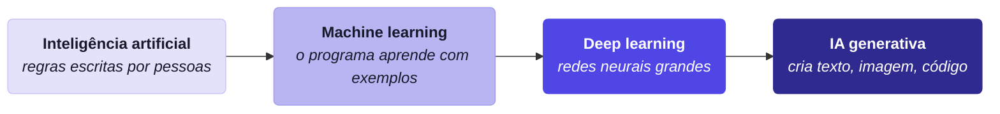
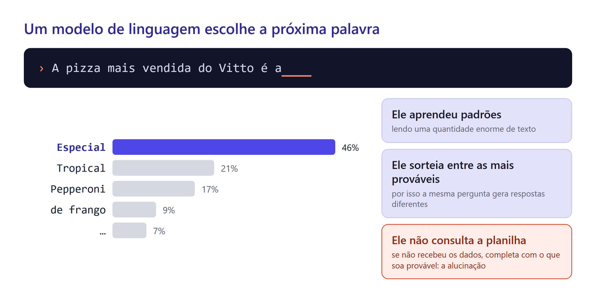

# Aula 6 · O Universo da IA e o Seu Site Pessoal

Vitto abriu uma vaga de estágio e recebeu quarenta currículos. Trinta e oito eram PDFs parecidos. Dois traziam um link: um site simples, com a história da pessoa, projetos e um jeito fácil de entrar em contato. Vitto chamou esses dois primeiro.

Hoje você publica o seu site. No caminho, vai entender o que é a IA generativa, por que ela erra, como esse universo se organiza e como pedir as coisas do jeito certo. Nas próximas aulas, cada projeto novo entra nesse site.

## O que é IA generativa

Inteligência artificial é o nome do campo inteiro: programas que fazem tarefas que pareciam exigir uma pessoa. Dentro dele há camadas.



A diferença prática está no que o programa entrega. Um filtro de spam é machine learning: recebe um e-mail e **classifica** ("spam" ou "não spam"). O ChatGPT é IA generativa: recebe um pedido e **cria** um e-mail novo, que não existia antes.

Na Aula 1 você viu a IA que classifica e prevê. A partir de agora, o foco é a que cria.

## Como um modelo de linguagem funciona

O coração do ChatGPT, do Claude e do Gemini é um **modelo de linguagem**. A ideia central cabe numa frase: ele escolhe a próxima palavra mais provável, depois a próxima, depois a próxima.



Pense no autocompletar do celular, só que treinado com uma quantidade enorme de texto: livros, sites, código, conversas. Ao ler tanto, o modelo aprendeu padrões de gramática, de fatos e até de raciocínio. Quando você escreve "A pizza mais vendida do Vitto é a", ele calcula quais continuações soam mais prováveis e sorteia uma delas.

Esse sorteio explica uma coisa que confunde muita gente: **a mesma pergunta gera respostas diferentes**. Não é defeito. É o jeito como o modelo funciona.

O modelo não lê palavras inteiras. Ele lê **tokens**, pedaços de palavra. "Pizza" pode ser um token só; "pizzaria" pode virar dois. Em português, cada token tem em média uns três ou quatro caracteres. Os tokens importam por dois motivos: eles definem quanto texto cabe numa conversa e, quando você usa a IA por API (Aula 10), definem quanto você paga.


**Treino em duas etapas.** Primeiro o modelo lê bilhões de páginas e aprende a continuar textos. Depois, pessoas avaliam milhares de respostas ("esta é útil, esta não é") e o modelo aprende a conversar, seguir instruções e recusar pedidos perigosos.


O treino termina numa data. Tudo o que aconteceu depois é desconhecido para o modelo. Essa é a **data de corte**. Por isso os apps de chat ganharam busca na web: quando você pergunta algo recente, o app pesquisa e entrega o resultado para o modelo ler.

## Por que a IA inventa

Pergunte a um chat, sem anexar nada: "qual foi a pizza mais vendida da Pizzaria do Vitto em 2025?". Ele pode responder, com toda a segurança, "a Margherita, com 18% das vendas". Nunca houve Margherita no cardápio do Vitto.

Isso se chama **alucinação**: uma resposta que soa certa e é falsa. Ela acontece porque o modelo foi treinado para produzir texto provável, não para dizer "não sei". Se ele não recebeu os dados, completa a lacuna com o que parece plausível.


A alucinação é mais perigosa justamente onde parece mais confiável: números, nomes, datas, citações e referências bibliográficas. Todo número que vai para um relatório precisa vir dos dados, nunca da "memória" do modelo.


Três atitudes reduzem o problema:

* **Dê os dados.** Anexe a planilha, cole o texto, aponte o arquivo. A IA passa a trabalhar sobre o que você deu.
* **Peça a fonte.** "De onde veio esse número?" obriga o modelo a mostrar o caminho.
* **Confira o que importa.** Você já sabe muita coisa sobre os dados do Vitto. Use esse conhecimento para checar.

## Janela de contexto: a mesa de trabalho

Tudo o que o modelo considera ao responder precisa estar na **janela de contexto**. Imagine uma mesa de trabalho. Em cima dela estão as instruções, a conversa até aqui, os arquivos que você anexou e os resultados das ferramentas. O que não está na mesa, o modelo não vê.


A mesa é grande, mas tem limite. Numa conversa muito longa, as primeiras mensagens saem pela borda e o modelo "esquece" o que você combinou no começo. Isso tem duas consequências práticas:

* **Assunto novo, conversa nova.** Uma conversa limpa, só com o que importa, dá respostas melhores do que uma conversa de duas horas sobre cinco temas.
* **Cada conversa começa vazia.** O chat de ontem não sabe o que você disse hoje, a menos que o app tenha um recurso de memória ou você cole o contexto de novo.

## O universo da IA em camadas

Há centenas de ferramentas de IA, e os nomes mudam a cada poucos meses. Em vez de decorar nomes, entenda as camadas. Qualquer ferramenta nova cabe numa delas.


**Base.** Tudo começa com dados, chips e treino. Treinar um modelo grande custa centenas de milhões de dólares, por isso poucas empresas fazem isso: OpenAI, Anthropic, Google, Meta, xAI, Mistral, DeepSeek, Alibaba e algumas outras.

**Modelos.** O resultado do treino é um modelo. Ele pode ser **fechado** ou ter **pesos abertos**.

* Um modelo fechado (GPT, Claude, Gemini) só pode ser usado pelos apps e pela API da empresa. Você nunca tem o arquivo do modelo.
* Um modelo de pesos abertos (Llama, Gemma, DeepSeek, Qwen, Mistral) pode ser baixado e rodado em qualquer computador potente. Uma empresa preocupada com sigilo pode rodá-lo nos próprios servidores, sem mandar dado nenhum para fora.

**Tipos de modelo.** Há modelos para texto e código, modelos de **raciocínio** (que "pensam" por alguns segundos ou minutos antes de responder e acertam mais em problemas difíceis), modelos de imagem, áudio e vídeo e modelos de **embeddings**, que você vai conhecer na Aula 10.

**Formas de usar.** É aqui que você entra.

| Forma de uso | O que é | Exemplo para o Vitto |
| --- | --- | --- |
| App de chat | você conversa num site ou aplicativo | pedir ideias de promoção para terça-feira |
| IA dentro de apps | o modelo aparece no programa que você já usa | resumir as reclamações numa planilha do Google |
| Agente | a IA executa tarefas no computador: cria arquivos, roda programas, abre o navegador | construir o dashboard de vendas |
| API | um programa seu conversa com o modelo | um robô que responde clientes no WhatsApp |
| Modelo local | o modelo roda no seu computador, sem internet | analisar dados sigilosos sem enviá-los a ninguém |


**Usuário avançado escolhe a ferramenta pela tarefa.** Pergunta rápida: chat. Pesquisa com fontes: chat com busca na web ou "pesquisa aprofundada". Trabalho sobre arquivos e código: agente. Dado sigiloso: modelo local ou plano empresarial que não treina com seus dados.


## Agentes e o Antigravity

Um chat responde. Um **agente** age. Ele recebe um objetivo, faz um plano, usa ferramentas (editor de arquivos, terminal, navegador), observa o resultado e repete até terminar. Na Aula 8 você vai ver esse ciclo em detalhe. Hoje basta usar.

O **Google Antigravity** é um ambiente de trabalho feito para agentes. Ele tem duas partes:

* **o editor**, onde você vê e edita os arquivos do projeto;
* **o painel do agente** (e o Agent Manager, que gerencia várias conversas de agente ao mesmo tempo).

O agente do Antigravity se comunica por **artefatos**: documentos que ele produz para você revisar antes e depois de trabalhar. Os principais são a lista de tarefas, o **plano de implementação** (o que ele pretende fazer, arquivo por arquivo), o resumo do que foi feito e capturas de tela do resultado.

O ponto mais importante: você pode pedir que o agente **planeje antes de agir**. No modo de planejamento (ou com o comando `/plan`), ele escreve o plano e para. Você lê, comenta o que está errado e só então clica em **Proceed** para ele executar.


O agente roda comandos no seu computador. Nas configurações do Antigravity, deixe-o **pedir sua aprovação antes de executar comandos no terminal**. Leia cada comando antes de aprovar. Se não entender, pergunte ao próprio agente: "o que esse comando faz?".



O plano gratuito do Antigravity tem uma cota de uso renovada semanalmente (outubro de 2026). Se a cota acabar no meio da aula, trabalhe em dupla com quem ainda tem cota.


## Técnica de prompting: a anatomia do pedido

Pedir "faz um site pra mim" funciona, mas o resultado é genérico. O agente preenche tudo o que você não disse com o que é mais comum. Um bom pedido tem até cinco partes:


* **Papel:** quem a IA deve ser. Muda o vocabulário e o nível da resposta.
* **Contexto:** quem é você, para quem é o resultado, por que ele existe.
* **Tarefa:** o que exatamente deve ser feito, com verbo claro.
* **Formato:** como o resultado deve vir (arquivo, tabela, tamanho, tom).
* **Limites:** o que **não** fazer. É a parte mais esquecida e a que mais evita retrabalho.

Compare os dois pedidos para o mesmo objetivo:

```text
Faz um site pessoal pra mim.
```

```text
Você é um designer de sites pessoais simples e acessíveis.
Sou estudante de Administração e quero um portfólio para estágios.
Crie a página inicial com: apresentação, formação, projetos e contato.
Use um único index.html com o CSS no próprio arquivo.
Não use frameworks e não invente informações sobre mim: onde faltar dado, deixe [PREENCHER].
Antes de criar, me mostre o plano.
```

O segundo pedido gasta trinta segundos a mais e economiza dez minutos de correções.


**Deixe a IA perguntar.** Termine pedidos importantes com: "Antes de começar, faça até 5 perguntas sobre o que não ficou claro." O modelo descobre as lacunas por você.


## Spec-driven development, parte 1: pense antes de pedir

Quando o pedido cresce, ele merece ir para um arquivo. Esse arquivo se chama **spec** (de *specification*, especificação). Ele descreve **o quê** você quer e **por quê**, sem se preocupar com **como** vai ser feito.

Trabalhar a partir de uma spec tem nome: **spec-driven development** (desenvolvimento guiado por especificação). A ideia do GitHub, que popularizou o termo, é simples: o problema raramente é a habilidade do agente; é o pedido vago. Com uma spec, o agente trabalha sobre algo claro, e você revisa cada etapa.

Nesta aula, a spec é curta. Na Aula 9, você vai ver o ciclo completo.

```markdown
# Spec: meu site pessoal

## Objetivo
Portfólio para conseguir estágio em [área]. Quem ler deve entender em 30 segundos quem sou e como falar comigo.

## Público
Recrutadores e gestores de pequenas empresas, lendo pelo celular.

## Conteúdo
- Apresentação: nome, curso, semestre, uma frase sobre o que procuro.
- Formação e cursos.
- Projetos: por enquanto vazio, com o texto "em breve". Vai receber os projetos das aulas 7 a 10.
- Contato: e-mail e LinkedIn.

## Estilo
Limpo, uma cor de destaque, boa leitura no celular. Referência: [link de um site que você acha bonito].

## Limites
- Nada de CPF, telefone, endereço ou data de nascimento.
- Nenhuma informação inventada.
- Um único index.html, sem frameworks.

## Pronto quando
- Abre no celular sem barra de rolagem lateral.
- Todos os links funcionam.
- Publicado em usuario.github.io.
```

A última seção, **"pronto quando"**, é a mais valiosa. Ela transforma "ficou bom?" em perguntas de sim ou não. O agente pode usá-la para conferir o próprio trabalho, e você também.

## Git, GitHub e GitHub Pages

Três nomes parecidos, três coisas diferentes:

* **Git** é um programa que tira "fotos" da sua pasta de projeto. Cada foto se chama **commit** e leva uma mensagem: "cria página inicial", "corrige link do LinkedIn". Se algo der errado, você volta para uma foto anterior.
* **GitHub** é um site que guarda essas fotos na nuvem. Enviar os commits para lá se chama **push**. Cada projeto fica num **repositório**.
* **GitHub Pages** é um serviço gratuito do GitHub que transforma um repositório em site público.


Você não precisa decorar comandos de Git. O agente sabe usá-los. Você precisa saber **o que** pedir ("faça um commit com a mensagem tal e envie para o GitHub") e **ler** o comando antes de aprovar.


No plano gratuito do GitHub, o repositório de um site do GitHub Pages é **público**: qualquer pessoa vê todos os arquivos, inclusive versões antigas. Nunca coloque ali senha, chave de API, telefone ou documento. Apagar depois não resolve: o histórico guarda tudo.


## Projeto: o seu site no ar

**Passo 1. Crie o repositório.** No GitHub, clique em **+** → **New repository**. O nome precisa ser exatamente `seuusuario.github.io` (troque pelo seu usuário, em minúsculas). Deixe **Public**, ative **Add README** e clique em **Create repository**.

**Passo 2. Traga o repositório para o computador.** Abra o Antigravity, abra uma pasta onde você guarda projetos (por exemplo, `Documentos/projetos-ia`) e peça:

```text
Clone o repositório https://github.com/SEUUSUARIO/SEUUSUARIO.github.io nesta pasta
e abra a pasta clonada como projeto.
```

Na primeira vez, o Git pode abrir o navegador para você entrar no GitHub. Entre e autorize.

**Passo 3. Escreva a spec.** Crie o arquivo `spec.md` na pasta do projeto, copie o modelo da seção anterior e preencha. Se travar, peça ajuda ao agente:

```text
Quero escrever a spec do meu site pessoal no arquivo spec.md, usando o modelo que vou colar.
Me entreviste: faça uma pergunta por vez e, no fim, preencha o arquivo com as minhas respostas.
Não invente nada que eu não tenha dito.
```

**Passo 4. Peça o plano.** Use o modo de planejamento:

```text
/plan Leia o spec.md e crie o meu site pessoal seguindo essa spec à risca.
Antes de implementar, mostre o plano e espere a minha aprovação.
```

Leia o plano de implementação. Ele bate com a spec? Ficou faltando alguma seção? Comente direto no plano e só depois clique em **Proceed**.

**Passo 5. Veja o resultado.** Peça ao agente para abrir o site no navegador e tirar uma captura de tela em tamanho de celular. Confira com o "pronto quando" da spec.

**Passo 6. Melhore em rodadas curtas.** Uma mudança por pedido funciona melhor que dez de uma vez:

```text
Na seção de apresentação, o texto está longo. Reduza para duas frases, mantendo as informações.
```

```text
Anexei um print de um site que eu gosto. Use a mesma ideia de cabeçalho no meu site,
sem copiar textos nem imagens.
```

**Passo 7. Publique.** Peça:

```text
Faça um commit com a mensagem "primeira versão do site" e envie para o GitHub.
```

Leia os comandos `git add`, `git commit` e `git push` antes de aprovar.

**Passo 8. Ligue o GitHub Pages.** No repositório, vá em **Settings** → **Pages**. Em **Branch**, escolha `main` e a pasta `/ (root)`, e salve. Em até 10 minutos, o site aparece em `https://seuusuario.github.io`. Abra no celular.


Repositórios com o nome `seuusuario.github.io` costumam publicar automaticamente pela branch `main`. Se a página de **Pages** já mostrar o endereço do site, o passo 8 já está feito.


## Checklist do projeto

* [ ] O site abre em `https://seuusuario.github.io`, inclusive no celular.
* [ ] Todos os itens do "pronto quando" da spec estão cumpridos.
* [ ] Nenhuma informação foi inventada pela IA (procure por `[PREENCHER]` e por frases que você não escreveria).
* [ ] Não há telefone, endereço, CPF ou data de nascimento em nenhum arquivo.
* [ ] A seção de projetos existe e está pronta para receber os próximos trabalhos.

## Truques de usuário avançado


* **Peça três versões.** "Me mostre três propostas de cabeçalho, bem diferentes entre si." Escolher é mais fácil que descrever.
* **Mostre em vez de descrever.** Um print vale um parágrafo de explicação. Os modelos atuais leem imagens.
* **Compare modelos.** Faça a mesma pergunta a dois chats diferentes. Onde eles discordam, há algo para conferir.
* **Recomece sem culpa.** Se a conversa desandou, abra uma nova e cole só a spec. Uma mesa limpa rende mais.


## Desafio extra

* Adicione um botão de modo escuro que lembre a escolha do visitante.
* Faça o site ter uma boa prévia quando o link for compartilhado no WhatsApp ou LinkedIn (título, descrição e imagem).
* Crie uma página `projetos.html` que liste os projetos com um cartão para cada um, já preparada para as próximas aulas.

## Referências

Anthropic. (2024). *Building effective agents*. Anthropic Engineering. https://www.anthropic.com/engineering/building-effective-agents

Delimarsky, D. (2025). *Spec-driven development with AI: Get started with a new open source toolkit*. The GitHub Blog. https://github.blog/ai-and-ml/generative-ai/spec-driven-development-with-ai-get-started-with-a-new-open-source-toolkit/

GitHub. (2026). *Creating a GitHub Pages site*. GitHub Docs. https://docs.github.com/en/pages/getting-started-with-github-pages/creating-a-github-pages-site

Google. (2026). *Agent*. Google Antigravity Documentation. https://antigravity.google/docs/agent

Google. (2026). *Implementation plan*. Google Antigravity Documentation. https://antigravity.google/docs/implementation-plan

Google. (2026). *Plans*. Google Antigravity Documentation. https://antigravity.google/docs/plans

Google. (2026). *Prompt design strategies*. Gemini API Documentation. https://ai.google.dev/gemini-api/docs/prompting-strategies

Zwingmann, T. (2022). *AI-powered business intelligence: Improving forecasts and decision making with machine learning*. O'Reilly Media.

> **Nota sobre o uso de IA:** este material foi produzido com apoio de inteligência artificial (Claude), a partir das referências listadas e dos dados fornecidos pelo professor.
