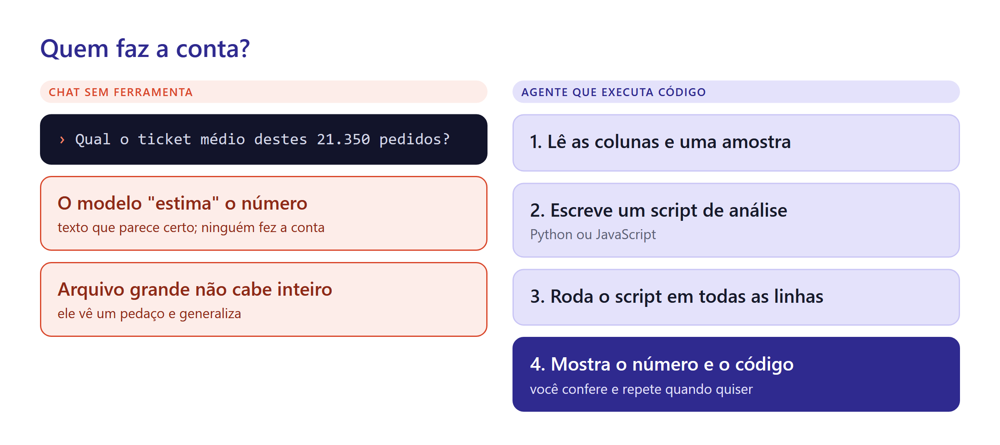
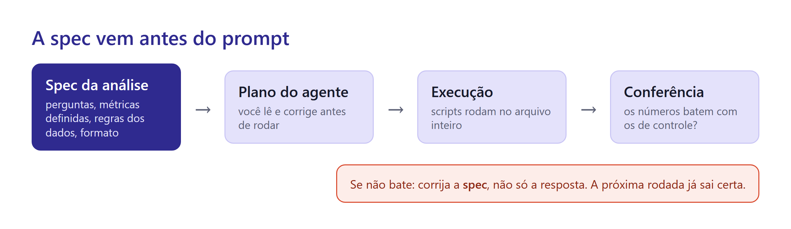
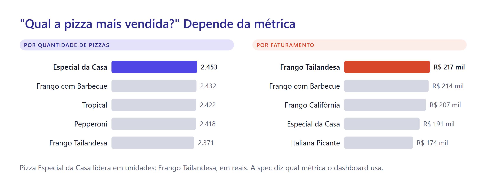
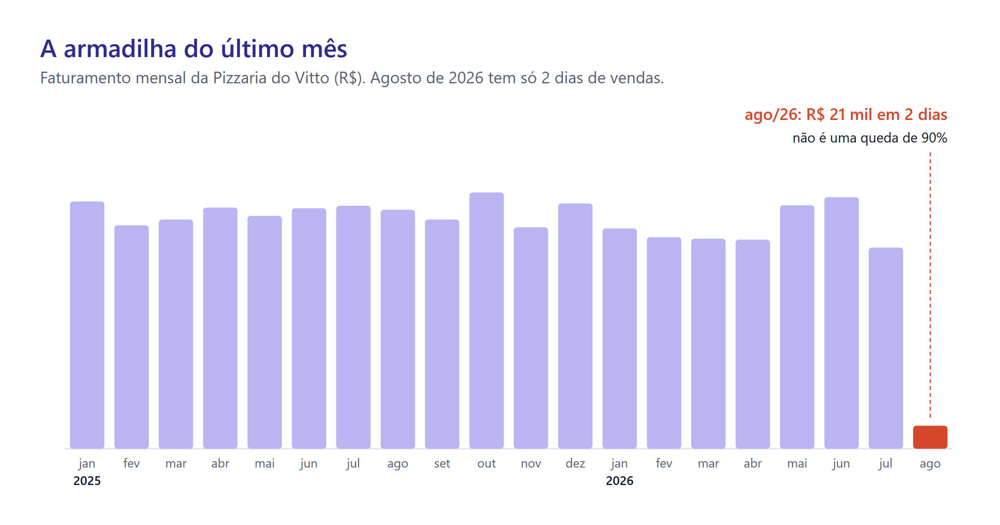

# Aula 7 · Relatório de Análise com IA

Vitto quer decidir o cardápio e a escala da equipe para o próximo ano. Ele mandou a planilha de vendas com um pedido curto: "me diz o que esses números mostram". São 48.620 linhas, de janeiro de 2025 a agosto de 2026.

Nas aulas 3 a 5, você fez esse tipo de análise à mão, com tabela dinâmica e gráfico. Hoje um agente faz o trabalho pesado. O seu papel muda: você define o que precisa ser respondido, revisa o plano e confere os números. No fim da aula, o relatório está publicado no seu site.

## A IA não é calculadora

Um modelo de linguagem escolhe a próxima palavra provável. Isso funciona bem para texto e mal para conta. Peça a um chat, sem ferramentas, a soma de quinhentos valores: ele vai devolver um número com cara de certo, que ninguém calculou.



A saída é dar ao modelo uma ferramenta. Em vez de "pensar" o número, o agente **escreve um programa** que faz a conta e **executa** esse programa sobre os dados. O número passa a vir do arquivo, não da imaginação do modelo. E você ganha um bônus: o código fica salvo. Amanhã, com a planilha atualizada, basta rodar de novo.


Regra prática: **texto, a IA escreve; número, a IA calcula com código**. Se um número apareceu sem script por trás, desconfie.


## Arquivo grande, mesa pequena

A planilha do Vitto tem 7,6 MB. Em tokens, isso passa de dois milhões, o que não cabe na janela de contexto da maioria dos modelos. Mesmo quando cabe, colar tudo é má ideia: o modelo se perde no meio de tantas linhas e a conversa fica cara e lenta.

Um agente bem orientado faz diferente:

1. lê o nome das colunas e as primeiras linhas, para entender o formato;
2. escreve um script que processa o arquivo inteiro;
3. traz para a conversa só o resultado: totais, tabelas, gráficos.

A mesa recebe o resumo, não a planilha. É o mesmo raciocínio de um bom analista: ninguém lê 48 mil linhas. Você resume e olha para o resumo.

## Modelos que pensam antes de responder

Os **modelos de raciocínio** gastam um tempo "pensando" antes de responder: quebram o problema em partes, testam caminhos e revisam o próprio rascunho. Eles acertam mais em tarefas com várias etapas, como planejar uma análise, e custam mais tempo (e mais tokens).

Use esse tipo de modelo para **planejar** a análise e revisar conclusões. Para tarefas simples ("troque a cor do gráfico"), um modelo rápido resolve. No Antigravity, você escolhe o modelo no painel do agente.

## O que pode ir para a IA

A planilha do Vitto não tem nenhum dado pessoal: não há nome, telefone nem endereço de cliente. Por isso ela pode ir para qualquer ferramenta. Nem sempre é assim.

A **LGPD** (Lei Geral de Proteção de Dados) protege qualquer informação que identifique uma pessoa. Se o arquivo tivesse o nome e o telefone de cada cliente, enviá-lo para um serviço de IA seria tratar dado pessoal, com regras e responsabilidades.


Antes de enviar um arquivo para a IA, pergunte: tem dado que identifica alguém? Tem segredo da empresa? Se sim, remova as colunas pessoais, troque nomes por códigos ou use uma ferramenta aprovada pela empresa. Planos gratuitos de várias ferramentas podem usar o que você envia para treinar modelos.


## Técnica de prompting: dicionário de dados e pergunta de negócio

O agente não sabe o que é `id_pedido`, nem que uma linha é um item e não um pedido. Se você não disser, ele adivinha. E um erro aqui contamina tudo: calcular o ticket médio dividindo por linhas em vez de pedidos dá um número errado com cara de certo.

Comece toda análise com duas coisas: o **dicionário de dados** (o que cada coluna significa) e a **pergunta de negócio** (que decisão o resultado vai apoiar).

```text
Dicionário de dados de vendas-pizzas.csv:
- Cada linha é UM ITEM vendido. Um pedido pode ter várias linhas.
- id_pedido: identifica o pedido. Use para contar pedidos.
- quantidade: número de pizzas daquele item.
- preco_total: valor do item em reais (já multiplicado pela quantidade).
- data_pedido: dia/mês/ano. hora_pedido: hh:mm:ss.
- tamanho: P, M, G, GG. categoria: Clássica, Especial, Vegetariana, Frango.

Pergunta de negócio: o Vitto vai decidir o cardápio e a escala da equipe do próximo ano.
```

## Técnica de prompting: plano primeiro, etapas depois

Pedir "analise tudo" de uma vez gera um relatório longo e raso. Duas técnicas resolvem.

**Peça o plano antes da execução.** Você corrige o rumo quando ainda é barato. É aqui que você pega o erro do denominador, a métrica errada ou a pergunta esquecida.

**Divida o trabalho em etapas.** Primeiro a limpeza e a conferência dos dados, depois cada pergunta, depois o texto do relatório. Cada etapa produz algo que você confere antes de seguir. Essa técnica tem nome: **encadeamento de prompts** (*prompt chaining*). Ela troca um pouco de velocidade por muito mais acerto.

Duas frases valem ouro no fim de qualquer pedido de análise:

```text
Liste as suposições que você fez sobre os dados.
Liste as limitações desta análise: o que os dados não permitem concluir.
```

## Spec-driven development, parte 2: a spec da análise

Na Aula 6, a spec descrevia um site. Agora ela descreve uma análise. A estrutura muda pouco: o quê, por quê, regras e "pronto quando".



A seção mais importante numa spec de análise é a de **métricas**. Veja por quê.



"Qual a pizza mais vendida?" tem duas respostas certas. Em unidades, ganha a Especial da Casa. Em faturamento, ganha a Frango Tailandesa. Se a spec não disser qual métrica usar, o agente escolhe por você, e cada rodada pode escolher diferente.

```markdown
# Spec: relatório anual da Pizzaria do Vitto

## Decisão que o relatório apoia
Cardápio e escala da equipe para o próximo ano.

## Perguntas
1. Como o faturamento evoluiu mês a mês?
2. Quais pizzas mais vendem em unidades e em faturamento? As vendas são concentradas em poucas pizzas?
3. Qual é o pedido típico: ticket médio e mediana do valor por pedido.
4. Em que horários e dias da semana o movimento se concentra?
5. Como se dividem as vendas por tamanho e por categoria?

## Métricas (definições obrigatórias)
- Faturamento = soma de preco_total.
- Pedidos = número de id_pedido distintos.
- Ticket médio = faturamento ÷ pedidos (nunca ÷ linhas).
- Pizzas vendidas = soma de quantidade.

## Regras dos dados
- O último mês da planilha está incompleto: identifique-o, mostre-o destacado e não o compare com meses completos.
- Procure problemas de qualidade (nomes fora do padrão, valores estranhos) e liste-os.

## Formato
- relatorio.html, um arquivo, em português, valores em R$ com vírgula decimal.
- Para cada pergunta: um gráfico, um parágrafo de leitura e o número principal.
- Gráficos seguindo as aulas 3 a 5: barras ordenadas, eixo começando no zero, um destaque de cor por gráfico.
- No fim: três recomendações para o Vitto, cada uma com uma limitação.

## Pronto quando
- Os números de controle batem (tabela fornecida pelo professor).
- Todo número do texto vem de um script salvo na pasta.
- Nenhuma afirmação de causa sem evidência ("vende mais PORQUE...").
```

## A armadilha do último mês

A planilha vai até 3 de agosto de 2026. Agosto tem só dois dias de vendas. Num gráfico mensal ingênuo, aparece uma queda dramática.



Você já viu isso na Aula 5: período incompleto no fim da série sempre parece uma queda. Um agente sem instrução pode escrever "o faturamento despencou 90% em agosto". A regra na spec evita o erro antes de ele acontecer.

## Números de controle

Use esta tabela para conferir o trabalho do agente. Se um número não bater, descubra por quê antes de seguir.

| Controle | Valor |
| --- | --- |
| Linhas (itens) | 48.620 |
| Pizzas vendidas (soma de quantidade) | 49.574 |
| Pedidos (id_pedido distintos) | 21.350 |
| Faturamento total | R\$ 4.089.300,25 |
| Ticket médio | R\$ 191,54 |
| Mediana do valor por pedido | R\$ 162,50 |
| Período | 01/01/2025 a 03/08/2026 |
| Pizzas no cardápio | 32 |
| Pizzas vendidas entre 12h e 13h59 | 26,6% |


Antes de rodar a análise, pergunte a um chat qualquer: "em que dia da semana uma pizzaria vende mais?". Ele provavelmente vai dizer sexta ou sábado. Na planilha do Vitto, o dia com mais pedidos é **segunda-feira** e o com menos é **sábado**. Um relatório que repete o senso comum sem olhar os dados está alucinando com elegância.


Repare também na pergunta 2. Nas aulas 3 a 5, você viu o Pareto como "poucos itens fazem a maior parte". Aqui, as 16 pizzas que mais faturam (metade do cardápio) somam 64% do faturamento. A concentração existe, mas está longe de 80/20. Um bom relatório diz isso; um relatório preguiçoso força a conclusão esperada.

## Regras permanentes do projeto: o arquivo AGENTS.md

Toda conversa nova começa com a mesa vazia. Repetir "calcule com código, use R\$, escreva em português" em cada pedido cansa e você esquece. A solução é um arquivo de **regras** que o agente lê sozinho, sempre.

No Antigravity, um arquivo `AGENTS.md` (ou `GEMINI.md`) na raiz do projeto é carregado automaticamente em toda conversa daquela pasta. Regras mais específicas podem ficar em `.agents/rules/`.

```markdown
# Regras deste projeto

- Todo número vem de código executado sobre o arquivo de dados. Nunca estime.
- Salve cada script em scripts/ com nome que diga o que faz.
- Português do Brasil. Dinheiro: R$ 1.234,56. Datas: dd/mm/aaaa.
- Antes de mudar algo grande, mostre o plano e espere aprovação.
- Se a spec for ambígua, pergunte em vez de escolher sozinho.
```

Isso tem um nome que você vai ouvir muito: **engenharia de contexto**. É decidir o que fica permanentemente na mesa do modelo. Um bom `AGENTS.md` vale mais que dez prompts caprichados.

## Projeto: o relatório do Vitto no seu site

**Passo 1. Prepare a pasta.** Abra o projeto do seu site no Antigravity. Crie a pasta `relatorio-vitto` com uma subpasta `dados`. Abra a [planilha de vendas](https://docs.google.com/spreadsheets/d/1blCNnBRkUsfui_Dfxx5otrY95CObraKghRKDCV7scSE/edit?usp=sharing), vá em **Arquivo → Fazer download → Valores separados por vírgula (.csv)** e salve como `relatorio-vitto/dados/vendas-pizzas.csv`.

**Passo 2. Crie as regras.** Crie `relatorio-vitto/AGENTS.md` com o conteúdo da seção anterior.

**Passo 3. Escreva a spec.** Crie `relatorio-vitto/spec.md` com o modelo acima. Ajuste o que quiser, mas mantenha a seção de métricas.

**Passo 4. Peça o plano.**

```text
/plan Leia relatorio-vitto/spec.md e relatorio-vitto/AGENTS.md.
Planeje a análise do arquivo relatorio-vitto/dados/vendas-pizzas.csv para gerar relatorio-vitto/relatorio.html.
O plano deve dizer: como cada métrica será calculada, como o mês incompleto será tratado
e quais scripts serão criados. Espere a minha aprovação.
```

Leia o plano procurando três coisas: o ticket médio divide por pedidos? O mês incompleto é tratado? Todas as cinco perguntas aparecem? Comente o que estiver errado.

**Passo 5. Execute em etapas.** Aprove o plano, mas peça primeiro só a conferência:

```text
Antes do relatório, rode só a etapa de conferência: imprima linhas, pizzas vendidas, pedidos,
faturamento total, ticket médio, mediana por pedido e o período dos dados.
Liste também os problemas de qualidade que encontrar.
```

Compare com a tabela de números de controle. Bateu? Siga. Não bateu? Pergunte "como você calculou X?" e corrija a **spec** se o erro vier de uma definição.

**Passo 6. Gere o relatório.** Peça o restante do plano. O agente vai instalar bibliotecas (como pandas e matplotlib, do Python) e pedir para rodar comandos. Leia e aprove.

**Passo 7. Revise como um chefe exigente.** Abra uma conversa nova e use o agente como revisor:

```text
Você é um gerente cético. Leia relatorio-vitto/relatorio.html e a spec.
Liste: (1) afirmações sem evidência nos dados, (2) conclusões de causa disfarçadas,
(3) itens do "pronto quando" que não foram cumpridos. Não corrija nada, só liste.
```

Depois peça as correções na conversa original. Um modelo que revisa o trabalho de outro, com critérios claros, encontra erros que o autor não vê.

**Passo 8. Publique.** Peça para adicionar o relatório à seção de projetos do site, com um cartão e um link. Depois:

```text
Faça commit com a mensagem "relatório da pizzaria" e envie para o GitHub.
```

Em alguns minutos, o relatório estará em `https://seuusuario.github.io/relatorio-vitto/relatorio.html`.

## Checklist do projeto

* [ ] Os números de controle batem.
* [ ] Agosto de 2026 aparece destacado como mês incompleto, sem conclusão de "queda".
* [ ] Existe uma pasta `scripts/` com os programas que geraram os números.
* [ ] Cada pergunta tem gráfico, leitura e número principal.
* [ ] As recomendações têm limitações e nenhuma afirma causa sem evidência.
* [ ] O relatório abre a partir do cartão na página de projetos do seu site.

## Truques de usuário avançado


* **Pergunte "como você calculou?".** A resposta revela erros de denominador em segundos.
* **Peça o resultado em duas versões:** uma para o Vitto (curta, sem jargão) e outra para um analista (com método e limitações).
* **Guarde os bons prompts.** Um prompt que funcionou é um ativo. Salve-o num arquivo `prompts.md` no projeto.
* **Separe autor e revisor.** Quem escreveu não deve ser quem revisa. Use outra conversa ou outro modelo para revisar.


## Desafio extra

* Acrescente uma análise por dia da semana **e** horário (um mapa de calor), útil para a escala da equipe.
* Gere uma versão "executiva" de uma página, para o Vitto ler em dois minutos.
* Peça ao agente para transformar a análise num script único que gera o relatório do zero com um comando. Teste apagando o HTML e rodando de novo.

## Referências

Anthropic. (2024). *Building effective agents*. Anthropic Engineering. https://www.anthropic.com/engineering/building-effective-agents

Brasil. (2018). *Lei nº 13.709, de 14 de agosto de 2018: Lei Geral de Proteção de Dados Pessoais (LGPD)*. https://www.planalto.gov.br/ccivil_03/_ato2015-2018/2018/lei/l13709.htm

Google. (2026). *Prompt design strategies*. Gemini API Documentation. https://ai.google.dev/gemini-api/docs/prompting-strategies

Google. (2026). *Rules*. Google Antigravity Documentation. https://antigravity.google/docs/rules

Zwingmann, T. (2022). *AI-powered business intelligence: Improving forecasts and decision making with machine learning*. O'Reilly Media.

> **Nota sobre o uso de IA:** este material foi produzido com apoio de inteligência artificial (Claude), a partir das referências listadas e dos dados fornecidos pelo professor.
