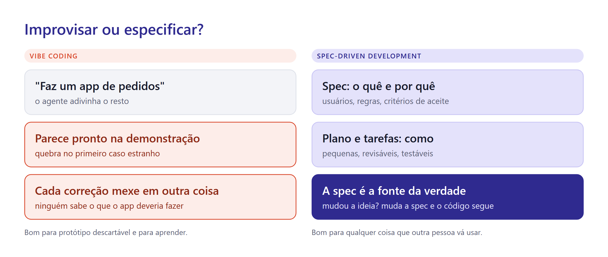
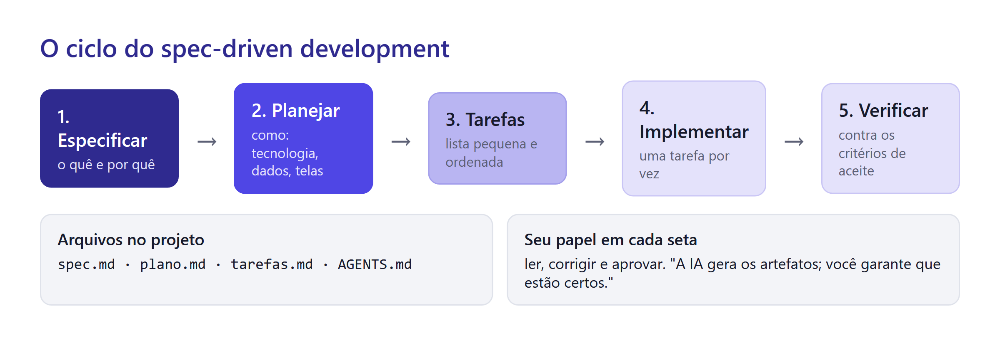
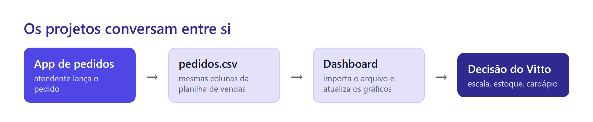

# Aula 9 · Um App de Pedidos com Spec-Driven Development

No balcão da pizzaria, os pedidos ainda são anotados em papel. Toda semana acontece o mesmo: uma soma errada, uma pizza anotada num tamanho que não existe, uma letra que ninguém entende na cozinha. E, no fim do mês, alguém digita tudo numa planilha.

Vitto quer um app no tablet do balcão. A atendente escolhe as pizzas, o app soma, guarda o pedido e, no fim do dia, exporta um arquivo que alimenta o dashboard da aula passada.

Um app que outra pessoa vai usar todo dia não pode ser improvisado. Hoje você vai construí-lo com o ciclo completo de **spec-driven development**.

## Vibe coding: o improviso

Em 2025, o pesquisador Andrej Karpathy popularizou o termo **vibe coding**: pedir à IA o que você quer, aceitar o que ela entrega sem ler o código e ir ajustando no olho até "parecer funcionar".

Para um protótipo descartável, é ótimo. Em meia hora você testa uma ideia. O problema aparece quando o protótipo vira produto.



Peça "faz um app de pedidos de pizza" e o agente vai adivinhar o resto: quais pizzas, quais tamanhos, como calcular, onde guardar. Na demonstração, tudo funciona. No primeiro dia de uso real, a atendente escolhe uma Cinco Queijos média, que não existe no cardápio, e o app aceita. Você pede uma correção, e o agente mexe em três coisas que já funcionavam. Ninguém sabe dizer o que o app **deveria** fazer, então ninguém consegue dizer se ele está certo.

## Spec-driven development: a spec manda

A virada do spec-driven development é uma troca de papéis. No jeito antigo, o código era a verdade e a documentação vinha depois, quando vinha. Aqui, **a spec é a fonte da verdade**: ela descreve o que o app faz e por quê, e o código existe para cumpri-la. Mudou a ideia? Muda a spec primeiro; o código segue.

O GitHub, que lançou um kit aberto para esse método em 2025, resume o papel de quem usa:

> "A IA gera os artefatos; você garante que estão certos."
> — Den Delimarsky, *Spec-driven development with AI* (The GitHub Blog)

O ciclo tem cinco etapas, e em cada passagem você lê, corrige e aprova.



1. **Especificar** — o quê e por quê. Quem usa, o que precisa conseguir fazer, quais regras valem, como saber que está pronto. Nenhuma palavra sobre tecnologia.
2. **Planejar** — como. Tecnologia, estrutura de arquivos, formato dos dados, telas. O plano precisa respeitar a spec e as restrições do mundo real.
3. **Tarefas** — uma lista pequena e ordenada. Cada tarefa cabe numa conversa e pode ser testada sozinha.
4. **Implementar** — uma tarefa por vez. Você revisa mudanças pequenas, não um monte de código de uma vez.
5. **Verificar** — cada critério de aceite da spec é testado. O que falhar volta para a etapa certa.

## O que vai numa spec

Uma boa spec tem cinco ingredientes.

**Histórias de usuário.** Uma frase no formato "Como [quem], quero [o quê], para [por quê]". O "para" é o que dá sentido à funcionalidade.

> Como atendente, quero ver só os tamanhos disponíveis de cada pizza, para não registrar um pedido impossível.

**Regras de negócio.** O que é sempre verdade, independentemente da tela. "O preço vem do cardápio, nunca é digitado." "A quantidade vai de 1 a 10."

**Critérios de aceite.** Cada um no formato **Dado / Quando / Então**: a situação inicial, a ação e o resultado esperado. É o "pronto quando" das aulas anteriores, agora com estrutura.

> **Dado** um pedido com 2 Pizzas Tropicais M e 1 Pizza Pepperoni G,
> **quando** a atendente olha o total,
> **então** o app mostra R\$ 208,75.

O critério acima tem números de verdade (Tropical M custa R\$ 66,25 e Pepperoni G, R\$ 76,25). Isso o torna testável: ou o app mostra R\$ 208,75 ou não mostra.

**Casos de borda.** O que acontece nas situações estranhas: pedido vazio, quantidade zero, página recarregada no meio do pedido, pizza com um só tamanho. É aqui que o vibe coding quebra.

**Fora do escopo.** O que o app **não** faz. "Sem pagamento, sem login, sem entrega." Isso impede o agente de inventar funcionalidades e impede você de crescer o projeto sem perceber.

## Técnica de prompting: deixe a IA entrevistar você

Escrever uma spec do zero é difícil. Responder perguntas é fácil. Então inverta os papéis: peça que o agente entreviste você.

```text
Vou construir um app de pedidos para o balcão de uma pizzaria. Ainda NÃO implemente nada.
Me entreviste para escrever a spec: faça uma pergunta por vez, sobre quem usa,
o que precisa fazer, regras, casos estranhos e o que fica fora.
Depois de umas 10 perguntas, escreva spec.md com: histórias de usuário, regras de negócio,
critérios de aceite em Dado/Quando/Então, casos de borda e fora do escopo.
```

Duas palavras fazem diferença nesse prompt: **"NÃO implemente"**. Sem elas, agentes tendem a sair codificando na primeira oportunidade.

## Técnica de prompting: revisão cruzada

Quem escreveu a spec não enxerga as próprias lacunas. Peça a **outro** modelo (ou a uma conversa nova) que a critique:

```text
Você é um analista de sistemas experiente. Leia spec.md e aponte:
(1) critérios de aceite que não dá para testar, (2) casos de borda que faltam,
(3) contradições entre regras, (4) decisões técnicas que vazaram para a spec.
Não reescreva a spec, só liste os problemas.
```

O item 4 é sutil. "Guardar no localStorage" é decisão técnica: pertence ao plano, não à spec. A spec diz "os pedidos do dia não se perdem se a página for recarregada".

## Plano e tarefas

Com a spec aprovada, o plano decide o **como**. Para o app do Vitto, a escolha mais simples que cumpre a spec é:

* uma página HTML com JavaScript, publicada no GitHub Pages, como os projetos anteriores;
* o cardápio num arquivo `cardapio.json`, gerado a partir da planilha de vendas;
* os pedidos guardados no próprio navegador do tablet;
* um botão que exporta os pedidos em CSV com as mesmas colunas da planilha de vendas.

Depois vem a lista de tarefas. Cada uma ganha um código e cabe numa conversa curta:

```markdown
# Tarefas
- T01 Gerar cardapio.json a partir de dados/vendas-pizzas.csv (32 pizzas, tamanhos e preços).
- T02 Tela de cardápio: lista de pizzas por categoria, só com os tamanhos disponíveis.
- T03 Carrinho: adicionar, alterar quantidade (1 a 10), remover, mostrar total.
- T04 Finalizar pedido: gera id_pedido, data e hora; bloqueia pedido vazio.
- T05 Guardar pedidos no navegador; lista de pedidos do dia.
- T06 Exportar CSV no formato da planilha de vendas.
- T07 Ajustes para tablet e celular.
```

## Testes: o agente prova que funciona

Um **teste automatizado** é um pequeno programa que confere um critério de aceite sozinho. Ele monta a situação ("Dado"), executa a ação ("Quando") e verifica o resultado ("Então"). Se alguém quebrar a soma no futuro, o teste avisa na hora.

Você não precisa escrever testes. Precisa pedir:

```text
Antes de implementar T03, escreva testes automatizados para os critérios de aceite do carrinho
que estão em spec.md. Rode os testes (eles devem falhar). Depois implemente T03 até todos passarem.
Me mostre o resultado dos testes.
```

Escrever o teste antes do código parece estranho, mas protege você de um vício dos agentes: escrever um teste que confirma o que o código já faz, em vez do que a spec pede.

## Onde ficam os dados

Um site no GitHub Pages não tem servidor nem banco de dados. Então onde o app guarda os pedidos? No **próprio navegador** do tablet, num espaço chamado armazenamento local.

Isso tem limites que a spec e o Vitto precisam conhecer:

* os pedidos ficam **só naquele aparelho**: o celular do Vitto não vê o que foi lançado no tablet;
* **limpar os dados do navegador apaga os pedidos**;
* por isso, a exportação diária de CSV não é enfeite: é o backup.


Se o app passasse a guardar nome e telefone de clientes, ele trataria **dados pessoais**, com as obrigações da LGPD. Decida isso na spec, de forma consciente. Para o Vitto, a escolha mais segura é não guardar dado de cliente nenhum.


Um sistema de verdade, com vários aparelhos e histórico seguro, precisaria de um servidor com banco de dados. É o desafio extra desta aula.

## A constituição do projeto

O kit de spec-driven development do GitHub chama de **constituição** o arquivo com as regras que valem para tudo no projeto, em toda funcionalidade. Nos três agentes, esse papel é do `AGENTS.md` que você conheceu na Aula 7.

```markdown
# Constituição do app de pedidos

- A spec.md é a fonte da verdade. Se o pedido contradiz a spec, pergunte antes de fazer.
- Trabalhe uma tarefa de tarefas.md por vez e marque-a como feita ao terminar.
- Todo critério de aceite tem um teste automatizado.
- Nada de bibliotecas novas sem justificar no plano.
- Nenhum dado pessoal de cliente é coletado ou guardado.
- Português do Brasil; dinheiro em R$ 1.234,56 na tela.
```

## Ferramentas que automatizam o ciclo

Você vai fazer o ciclo à mão, com três arquivos (`spec.md`, `plano.md`, `tarefas.md`). É assim que se aprende, e funciona em qualquer agente.

No mercado, há ferramentas que automatizam essas etapas com comandos. O **Spec Kit**, do GitHub, é o exemplo mais conhecido: ele cria a constituição e oferece um comando para cada etapa (especificar, esclarecer, planejar, criar tarefas, implementar), e funciona com vários agentes.


**Transforme o seu processo numa skill.** As skills seguem um formato aberto, adotado por vários agentes. No Antigravity, uma **skill** é uma pasta com um arquivo `SKILL.md` contendo instruções para um tipo de tarefa. O agente vê o nome e a descrição de cada skill e só lê as instruções completas quando a tarefa combina. Crie `.agents/skills/spec/SKILL.md` com o seu roteiro de entrevista e a estrutura da spec. Daí em diante, basta digitar `/spec` para começar um projeto novo do jeito certo.


```markdown
---
name: spec
description: Conduz a escrita de uma spec antes de qualquer código. Use quando o usuário quiser começar um projeto ou uma funcionalidade nova.
---

1. Não escreva código nesta etapa.
2. Entreviste o usuário, uma pergunta por vez: usuários, objetivo, regras, casos estranhos, fora do escopo.
3. Escreva spec.md com: histórias de usuário, regras de negócio,
   critérios de aceite (Dado/Quando/Então), casos de borda, fora do escopo.
4. Liste os critérios que ainda não são testáveis e pergunte como torná-los testáveis.
```

## Projeto: o app de pedidos do Vitto

**Passo 1. Prepare a pasta e o cardápio.** No projeto do site, crie `app-pedidos/` com `dados/vendas-pizzas.csv` dentro. Copie a constituição acima para `app-pedidos/AGENTS.md`. Depois:

```text
Leia app-pedidos/dados/vendas-pizzas.csv e gere app-pedidos/cardapio.json com cada pizza:
nome, código (sabor_pizza sem o sufixo de tamanho), categoria, ingredientes e os tamanhos
que existem com o preço de cada um. Os preços vêm como texto ("R$ 66,25"): guarde como número. Mostre quantas pizzas encontrou e quais têm um só tamanho.
```

Confira: são 32 pizzas. A Cinco Queijos só existe em G; a Mega Carne, só em P; a Quatro Queijos, em M e G; a Grega é a única com GG. E a "The Brie Carre Pizza" está em inglês, com ingredientes sem tradução: peça ao agente para traduzi-los no cardápio e anote isso na spec.

**Passo 2. Escreva a spec pela entrevista.** Use o prompt de entrevista desta aula. Garanta que a spec tenha, no mínimo, estes critérios:

```markdown
## Critérios de aceite (mínimo)
- Dado o cardápio, quando a atendente escolhe a Pizza Cinco Queijos, então só o tamanho G aparece.
- Dado um pedido com 2 Pizzas Tropicais M e 1 Pizza Pepperoni G, quando ela olha o total, então vê R$ 208,75.
- Dado um pedido vazio, quando ela toca em Finalizar, então vê um aviso e nada é salvo.
- Dado um pedido finalizado, quando a página é recarregada, então o pedido continua na lista do dia.
- Dado três pedidos finalizados, quando ela exporta, então o CSV tem uma linha por item,
  com as colunas exatas de vendas-pizzas.csv, na mesma ordem e no mesmo formato (preços como "R$ 66,25").
```

**Passo 3. Faça a revisão cruzada.** Abra uma conversa nova (de preferência com outro modelo) e use o prompt de revisão cruzada. Corrija a spec com o que fizer sentido. Faça commit: "spec do app de pedidos".

**Passo 4. Plano e tarefas.**

```text
Leia app-pedidos/spec.md e app-pedidos/AGENTS.md. Escreva app-pedidos/plano.md
(tecnologia, arquivos, formato dos dados, telas) e app-pedidos/tarefas.md (tarefas pequenas
com códigos T01, T02...). Mostre como cada critério de aceite será testado. Não implemente ainda.
```

**Passo 5. Implemente uma tarefa por vez.** Para cada tarefa:

```text
Implemente a próxima tarefa pendente de tarefas.md. Escreva os testes antes, rode, implemente
até passarem, marque a tarefa como feita e me mostre o resultado dos testes.
```

Faça um commit ao fim de cada tarefa. Se algo sair errado, você volta só uma tarefa.

**Passo 6. Verifique contra a spec.** Ao fim, peça a verificação completa, com evidência:

```text
Teste no navegador, em tamanho de tablet, cada critério de aceite de spec.md.
Responda em tabela (critério | passou? | evidência) e anexe capturas de tela.
```

**Passo 7. Feche o ciclo com o dashboard.** Lance três ou quatro pedidos de teste, exporte o CSV e importe no dashboard da Aula 8 (se você fez o botão "Importar CSV"). Os pedidos que você lançou aparecem nos gráficos.



**Passo 8. Publique.** Peça ao agente o cartão na página de projetos e a publicação no GitHub, com confirmação do endereço. O app estará em `https://seuusuario.github.io/app-pedidos/`. Abra no celular e lance um pedido.

## Checklist do projeto

* [ ] `spec.md`, `plano.md` e `tarefas.md` existem e estão coerentes entre si.
* [ ] Todos os critérios de aceite passam, com evidência.
* [ ] Não é possível escolher um tamanho que não existe para a pizza.
* [ ] O CSV exportado tem exatamente as colunas da planilha de vendas.
* [ ] O app não coleta nenhum dado pessoal.
* [ ] Há um commit por tarefa.

## Truques de usuário avançado


* **"Não implemente ainda"** é a frase mais útil do spec-driven development.
* **Mude a spec, não o código.** Quando o Vitto pedir uma mudança, atualize a spec primeiro e peça ao agente para alinhar o resto.
* **Uma tarefa, uma conversa.** Conversas curtas e focadas erram menos. Os arquivos guardam o contexto entre elas.
* **Peça os testes antes do código.** É a melhor defesa contra o agente que "acha" que terminou.


## Desafio extra

* Guarde os pedidos num banco de dados na nuvem (por exemplo, Supabase ou Firebase), para o Vitto ver os pedidos do tablet no celular. Atualize a spec antes.
* Faça o app funcionar sem internet e poder ser "instalado" na tela do tablet (um PWA).
* Crie o relatório de fechamento do dia: total vendido, número de pedidos, pizza campeã do dia.
* Instale o Spec Kit e refaça uma funcionalidade usando os comandos dele. Compare com o processo manual.

## Referências

Brasil. (2018). *Lei nº 13.709, de 14 de agosto de 2018: Lei Geral de Proteção de Dados Pessoais (LGPD)*. https://www.planalto.gov.br/ccivil_03/_ato2015-2018/2018/lei/l13709.htm

Delimarsky, D. (2025). *Spec-driven development with AI: Get started with a new open source toolkit*. The GitHub Blog. https://github.blog/ai-and-ml/generative-ai/spec-driven-development-with-ai-get-started-with-a-new-open-source-toolkit/

GitHub. (2026). *Spec Kit* [Repositório de software]. https://github.com/github/spec-kit

Google. (2026). *Agent skills*. Google Antigravity Documentation. https://antigravity.google/docs/skills

Google. (2026). *Rules*. Google Antigravity Documentation. https://antigravity.google/docs/rules

> **Nota sobre o uso de IA:** este material foi produzido com apoio de inteligência artificial (Claude), a partir das referências listadas e dos dados fornecidos pelo professor.
