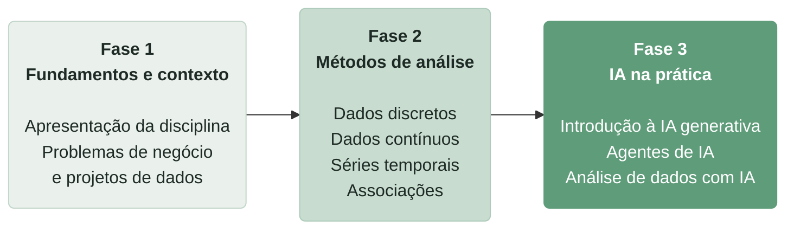
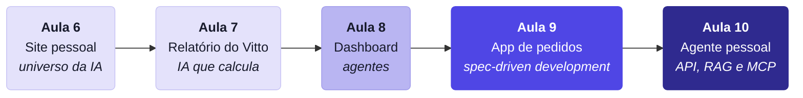

# Roadmap

Nesta disciplina vamos seguir um caminho claro e estruturado: primeiro o contexto, depois os métodos de análise, e só então a inteligência artificial aplicada.

Cada fase resolve um problema da anterior. A Fase 1 explica por que analisar dados muda uma decisão. A Fase 2 entrega as ferramentas para analisar. A Fase 3 usa IA para fazer em minutos o que a Fase 2 faz em horas — e para responder perguntas que a Fase 2 sozinha não alcança.

## Fase 3 · IA na prática

Na Fase 3, cada aula entrega um projeto publicado. Os conceitos de IA, as técnicas de prompting e o spec-driven development aparecem quando o projeto precisa deles, do mais básico ao mais avançado.

Antes da Aula 6, siga a página [Prepare o seu computador](ia-preparacao.md). As técnicas de todas as aulas estão reunidas no [Caderno de prompts e specs](ia-caderno-de-prompts.md).
